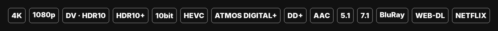
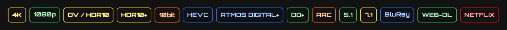
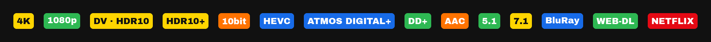
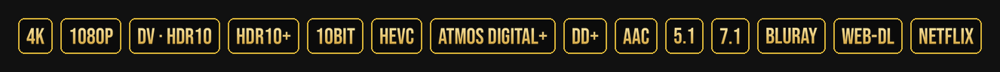
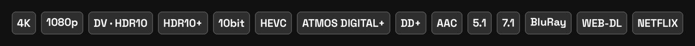
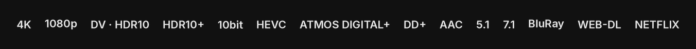
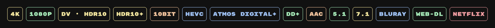
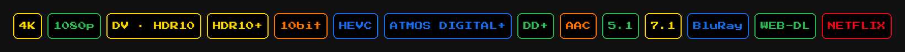
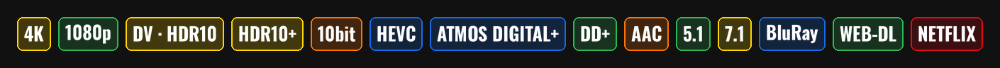

# Nuvio badges

Badge packs for [Nuvio](https://github.com/NuvioMedia/NuvioMobile) that also show up **in the player**, not only in the stream list.

## Why this exists

Nuvio's player builds a short line from the video that is playing, for example
`1080p FHD HEVC H.265 10bit AAC 5.1`, and runs the badge rules against it.
The rules in [kingsizew/badges](https://github.com/kingsizew/badges) only match when the text
looks like a full filename (a `.mkv` name, two resolutions, or a line break).
So in the player you only got `FHD` and `5.1`.

These packs keep the same rules with that filename check removed, and add a plain fallback to the
channel rules (7.1 / 6.1 / 5.1 / 2.0). The stream list still behaves the same.

`BluRay`, `WEB-DL`, `NETFLIX` and other source tags can never show in the player. Nuvio's player
only knows what is inside the video stream, not the file name.

## How to use

1. Nuvio → Settings → Streams → badge URLs → add one of the URLs below.
2. Turn on **Show in player**.
3. Under **Player badges**, pick the pack you want the player to use. You can keep a different pack for the stream list.

## Packs

### Classic
The original kingsizew images (loaded from their repo), with the player fix.

```
https://raw.githubusercontent.com/weebzone/nuvio-badges/main/packs/classic.json
```

### Mono
White bold text in a thin grey outline.



```
https://raw.githubusercontent.com/weebzone/nuvio-badges/main/packs/mono.json
```

### Neon
Glowing text in each badge's colour.



```
https://raw.githubusercontent.com/weebzone/nuvio-badges/main/packs/neon.json
```

### Solid
Filled colour pills.



```
https://raw.githubusercontent.com/weebzone/nuvio-badges/main/packs/solid.json
```

### Gold
Gold gradient on black, cinema style.



```
https://raw.githubusercontent.com/weebzone/nuvio-badges/main/packs/gold.json
```

### Glass
Frosted see-through chips.



```
https://raw.githubusercontent.com/weebzone/nuvio-badges/main/packs/glass.json
```

### Minimal
Just the text, no box.



```
https://raw.githubusercontent.com/weebzone/nuvio-badges/main/packs/minimal.json
```

### Pastel
Soft colours, rounded mono font.



```
https://raw.githubusercontent.com/weebzone/nuvio-badges/main/packs/pastel.json
```

### Retro
8-bit pixel font on black.



```
https://raw.githubusercontent.com/weebzone/nuvio-badges/main/packs/retro.json
```

### Condensed
Tall narrow type, fits more badges in a row.



```
https://raw.githubusercontent.com/weebzone/nuvio-badges/main/packs/condensed.json
```

## Build

```
pip install pillow
python3 build.py   # fetches the upstream rules, writes packs/, images/, previews/
python3 check.py   # tests the rules with Java's regex engine (needs a JDK)
```

Rules come from [kingsizew/badges](https://github.com/kingsizew/badges). Fonts in `fonts/` are from
Google Fonts under the SIL Open Font License.
